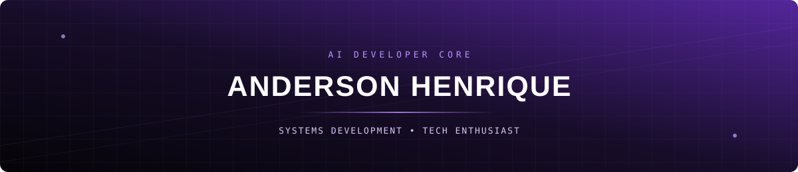

<div align="center">



<br>


<br>


</div>

---

## `01` // ABOUT ME

```yaml
name: Anderson Henrique
location: Natal, Rio Grande do Norte, Brazil
education: IT Technician
current_role: Systems Support Intern
company: Nutri Infantil

interests:
  - Software Development
  - Process Automation
  - Data Manipulation
  - Backend Development
  - Systems and Infrastructure
  - Problem Solving

mindset: "Learning by building."
```

Sou técnico em Informática e atualmente atuo como **Estagiário em Suporte de Sistemas na Nutri Infantil**.

Minha experiência envolve suporte a sistemas, utilização de ferramentas de CRM, organização e manipulação de grandes volumes de dados e investigação de problemas operacionais.

Tenho interesse especial em desenvolvimento de software, automação de processos e criação de soluções que facilitem atividades do dia a dia.

Gosto de entender como as coisas funcionam, investigar problemas e transformar necessidades reais em soluções práticas.

Atualmente, estou aprofundando meus conhecimentos em programação, especialmente Python, lógica de programação e fundamentos de desenvolvimento de sistemas.

---

## `02` // TECH STACK

<div align="center">

### Programming Languages


<sub>Python em desenvolvimento. Conhecimentos fundamentais em C e C++.</sub>

<br><br>

### Development & Version Control


<br><br>

### Databases & Backend


<sub>Estudando SQL, bancos de dados e fundamentos de desenvolvimento backend.</sub>

<br><br>

### Web & CMS


<sub>Conhecimentos introdutórios em tecnologias web e WordPress.</sub>

</div>

---

## `03` // TOOLS & PLATFORMS

<div align="center">


</div>
<br>
<sub><b>Professional environment:</b> ferramentas utilizadas ou exploradas em atividades de suporte, organização de dados e processos operacionais.</sub>

---

## `04` // PROJECTS & EXPERIENCE

<table>
<tr>
<td width="50%" valign="top">

### 🖥️ Linux Webmail Server

**Infrastructure & Networking**

Implantação e configuração de um servidor de Webmail utilizando ferramentas do ecossistema Linux.

**Technologies:**
- Rocky Linux
- Postfix
- Dovecot
- Apache
- SquirrelMail
- SMTP / IMAP
- SSH and SSL/TLS

</td>
<td width="50%" valign="top">

### ⚙️ Data Processing & Automation

**Data Management**

Desenvolvimento de soluções para organização, comparação e identificação de possíveis duplicidades em grandes bases de dados.

**Technologies:**
- Google Apps Script
- Google Sheets
- JavaScript
- Data Processing
- Data Validation

</td>
</tr>

<tr>
<td width="50%" valign="top">

### 🔄 Systems Support & CRM

**Professional Experience**

Atuação no suporte a ferramentas internas, investigação de falhas e organização de processos operacionais.

**Technologies:**
- Clint CRM
- WhatsApp Business Platform
- Meta Business
- n8n
- Workflow Analysis

</td>
<td width="50%" valign="top">

### 🌐 WordPress & Web Development

**Learning in Progress**

Exploração de ferramentas de gerenciamento de conteúdo e desenvolvimento web, com foco em estrutura, personalização e funcionalidades.

**Technologies:**
- WordPress
- HTML
- CSS
- Website Management

</td>
</tr>
</table>

---

## `05` // CURRENT OBJECTIVES

<div align="center">


</div>

```bash
anderson@dev:~$ cat current_objectives.txt

[IN PROGRESS] Python
[IN PROGRESS] Programming Logic
[IN PROGRESS] Data Structures
[IN PROGRESS] SQL & Databases
[IN PROGRESS] Git & GitHub

[NEXT] Backend Development
[NEXT] Django
[NEXT] REST APIs
[NEXT] Database Integration

[EXPLORING] JavaScript
[EXPLORING] Docker
[EXPLORING] Software Architecture

anderson@dev:~$ echo "Keep learning. Keep building."

Keep learning. Keep building.
```

---

## `06` // GITHUB ANALYTICS

<div align="center">


<br><br>


<br><br>


</div>

<sub>Top Languages representa a distribuição de linguagens nos repositórios analisados, não uma classificação de domínio técnico.</sub>

---

## `07` // GITHUB TROPHIES

<div align="center">


</div>

---

## `08` // CONTRIBUTION MATRIX

<div align="center">

<picture>
  <source media="(prefers-color-scheme: dark)" srcset="https://raw.githubusercontent.com/andersonhrq/andersonhrq/output/github-contribution-grid-snake-dark.svg"/>
  <source media="(prefers-color-scheme: light)" srcset="https://raw.githubusercontent.com/andersonhrq/andersonhrq/output/github-contribution-grid-snake.svg"/>
  
</picture>

</div>

---

## `09` // CONNECT WITH ME

<div align="center">

<a href="https://github.com/andersonhrq">
  
</a>

<a href="mailto:medeirosanderson31@gmail.com">
  
</a>

</div>

---

<div align="center">


### `SYSTEM MESSAGE`

**"Every problem is an opportunity to build something better."**

<sub>Designed & Developed by Anderson Henrique | 2026</sub>

<br>


</div>
